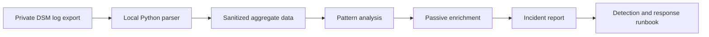

# Synology Incident Response Lab

A security investigation built from a real Synology DSM system-log export from my homelab. The lab demonstrates evidence handling, log parsing, detection engineering, threat-intelligence enrichment, MITRE ATT&CK mapping, incident reporting, and response planning.

The investigation found **2,052 automatic source blocks** over the evidence window:

- **2,047 SSH blocks** (99.76%)
- **5 DSM blocks** (0.24%)
- **2,052 unique source IP addresses** across **1,648 /24 networks**
- a peak of **57 blocks in one day**
- **no successful authentication event identified in this export**

The evidence supports a conclusion of persistent, likely automated authentication attempts against Internet-reachable services. It does **not** prove successful access, compromise, or attribution to a specific actor.

## Investigation Question

What can Synology Auto Block events reveal about repeated authentication attempts, and what additional evidence is required to determine whether any attempt succeeded?

## Workflow



## Findings at a Glance

- The activity is heavily concentrated on SSH, with only five DSM blocks.
- Every blocked source IP appears once in the export, but several /24 networks recur, suggesting address rotation within broader scanning infrastructure.
- The five highest-volume network clusters account for 223 events.
- Passive enrichment placed representatives from those clusters in European hosting/network-provider space; four representatives appeared in multiple AlienVault OTX pulses.
- ASN, geography, and reputation data provide context only. They do not establish attacker identity or intent.
- Synology Auto Block records are a defensive outcome, not the underlying authentication telemetry. The export does not show how many attempts triggered each block.

## Repository Contents

- [`reports/IR-001-persistent-authentication-attempts.md`](reports/IR-001-persistent-authentication-attempts.md) — complete investigation and incident report
- [`scripts/analyze_synology_export.py`](scripts/analyze_synology_export.py) — standard-library parser that produces sanitized aggregate JSON
- [`data/sanitized-findings.json`](data/sanitized-findings.json) — public-safe statistics derived from the private evidence
- [`detections/synology-auto-block.yml`](detections/synology-auto-block.yml) — portable detection specification
- [`threat-intel/enrichment-methodology.md`](threat-intel/enrichment-methodology.md) — enrichment process and analytic limitations
- [`runbooks/nas-authentication-attack.md`](runbooks/nas-authentication-attack.md) — triage, containment, eradication, and recovery workflow
- [`evidence/README.md`](evidence/README.md) — evidence-handling and sanitization notes

## Run the Analyzer

The parser uses only the Python standard library and accepts a local Synology HTML export:

```bash
python3 scripts/analyze_synology_export.py /path/to/private-synology-export.html
```

It emits aggregate JSON to standard output. Raw IP addresses, usernames, event text, hostnames, and paths are never emitted. The `.gitignore` excludes common raw-export formats by default.

## MITRE ATT&CK Context

- **T1110 — Brute Force:** inferred from automatic blocks triggered by repeated authentication failures
- **T1133 — External Remote Services:** relevant to authentication attempts against externally reachable SSH and DSM services

These mappings describe observed or reasonably inferred behavior. They are not claims of compromise.

## Defensive Recommendations

1. Remove direct Internet exposure for SSH and DSM when it is not operationally required.
2. Prefer VPN-based administrative access and tightly scoped firewall allowlists.
3. Require SSH keys, disable password and root login, and enforce MFA for DSM.
4. Correlate block events with successful-login, account-change, firewall, and router logs.
5. Forward security telemetry to a central collector and alert on higher-confidence sequences.
6. Keep DSM and packages patched and verify recoverable, offline or immutable backups.

## Privacy and Scope

The raw log export is not included. Public data uses aggregate counts and synthetic network tokens. Source addresses, account labels, host details, file paths, share names, and unrelated operational events remain private.

This is a homelab security investigation, not professional SOC casework. It is intended to demonstrate an evidence-based analysis process without overstating what the available logs prove.
